This package uses OpenCV camera calibration, described
[here](http://docs.opencv.org/modules/calib3d/doc/camera_calibration_and_3d_reconstruction.html).
For detailed information on the parameters produced by the calibration,
see [this description](https://index.ros.org/p/image_pipeline).

The code API listed for this package is for convenience only. This
package has no supported code API.

For pinhole type cameras this package names the distortion model as
**plumb_bob** or **rational_polynomial**, depending on number of
parameters used. See
[documentation](http://docs.ros.org/melodic/api/sensor_msgs/html/distortion__models_8h.html)

Support for fisheye type of camera introduced in melodic.

For fisheye type cameras this package uses **equidistant** distortion
model but names it as **fisheye**.

For fisheye type cameras this package uses **equidistant** distortion
model with the name **equidistant**, according to
[documentation](http://docs.ros.org/melodic/api/sensor_msgs/html/distortion__models_8h.html).

## Supported hardware

`camera_calibration` will work with any camera driver node satisfying
the standard ROS camera interface. See the
[image_pipeline hardware requirements](https://index.ros.org/p/image_pipeline).

## Tutorials

There are tutorials on how to run the calibration tool for
[monocular](#how-to-calibrate-a-monocular-camera)
and
[stereo](#how-to-calibrate-a-stereo-camera)
cameras.

## Usage

### Camera Calibrator

To run the `cameracalibrator.py` node for a monocular camera using an
8x6 chessboard with 108mm squares:


```
rosrun camera_calibration cameracalibrator.py --size 8x6 --square 0.108 image:=/my_camera/image camera:=/my_camera
```

 When you click on the "Save" button after a
succesfull calibration, the data (calibration data and images used for
calibration) will be written to /tmp/calibrationdata.tar.gz.

To run the `cameracalibrator.py` node for a stereo camera:


```
rosrun camera_calibration cameracalibrator.py --size 8x6 --square 0.108 right:=/my_stereo/right/image_raw left:=/my_stereo/left/image_raw left_camera:=/my_stereo/left right_camera:=/my_stereo/right
```

 `cameracalibrator.py` supports the following
options:


```
Chessboard Options:
    You must specify one or more chessboards as pairs of --size and
    --square options.

    -p PATTERN, --pattern=PATTERN
                        calibration pattern to detect - 'chessboard',
                        'circles', 'acircles'
    -s SIZE, --size=SIZE
                        chessboard size as NxM, counting interior corners
                        (e.g. a standard chessboard is 7x7)
    -q SQUARE, --square=SQUARE
                        chessboard square size in meters

  ROS Communication Options:
    --approximate=APPROXIMATE
                        allow specified slop (in seconds) when pairing images
                        from unsynchronized stereo cameras
    --no-service-check  disable check for set_camera_info services at startup

  Calibration Optimizer Options:
    --fix-principal-point
                        fix the principal point at the image center
    --fix-aspect-ratio  enforce focal lengths (fx, fy) are equal
    --zero-tangent-dist
                        set tangential distortion coefficients (p1, p2) to
                        zero
    -k NUM_COEFFS, --k-coefficients=NUM_COEFFS
                        number of radial distortion coefficients to use (up to
                        6, default 2)
```


cameracalibrator.py supports the following options:


```
Chessboard Options:
    You must specify one or more chessboards as pairs of --size and
    --square options.

    -p PATTERN, --pattern=PATTERN
                        calibration pattern to detect - 'chessboard',
                        'circles', 'acircles'
    -s SIZE, --size=SIZE
                        chessboard size as NxM, counting interior corners
                        (e.g. a standard chessboard is 7x7)
    -q SQUARE, --square=SQUARE
                        chessboard square size in meters

  ROS Communication Options:
    --approximate=APPROXIMATE
                        allow specified slop (in seconds) when pairing images
                        from unsynchronized stereo cameras
    --no-service-check  disable check for set_camera_info services at startup
    --queue-size=QUEUE_SIZE
                        image queue size (default 1, set to 0 for unlimited)

  Calibration Optimizer Options:
    --fix-principal-point
                        for pinhole, fix the principal point at the image
                        center
    --fix-aspect-ratio  for pinhole, enforce focal lengths (fx, fy) are equal
    --zero-tangent-dist
                        for pinhole, set tangential distortion coefficients
                        (p1, p2) to zero
    -k NUM_COEFFS, --k-coefficients=NUM_COEFFS
                        for pinhole, number of radial distortion coefficients
                        to use (up to 6, default 2)
    --fisheye-recompute-extrinsicsts
                        for fisheye, extrinsic will be recomputed after each
                        iteration of intrinsic optimization
    --fisheye-fix-skew  for fisheye, skew coefficient (alpha) is set to zero
                        and stay zero
    --fisheye-fix-principal-point
                        for fisheye,fix the principal point at the image
                        center
    --fisheye-k-coefficients=NUM_COEFFS
                        for fisheye, number of radial distortion coefficients
                        to use fixing to zero the rest (up to 4, default 4)
    --fisheye-check-conditions
                        for fisheye, the functions will check validity of
                        condition number
    --disable_calib_cb_fast_check
                        uses the CALIB_CB_FAST_CHECK flag for
                        findChessboardCorners
    --max-chessboard-speed=MAX_CHESSBOARD_SPEED
                        Do not use samples where the calibration pattern is
                        moving faster                      than this speed in
                        px/frame. Set to eg. 0.5 for rolling shutter cameras.
```


#### Unsynchronized Stereo

By default, the `image_pipeline` assumes that stereo cameras are
triggered to capture images simultaneously, and that matching image
pairs have identical timestamps. This is the ideal situation, but
requires hardware support.

Starting in Diamondback, you will be able to calibrate stereo pairs that
are not (or inexactly) synchronized.

To enable approximate timestamp matching, give the
`\--approximate=0.01` option. This permits a "slop" of 0.01s between
image pairs. If you still don't see a display window, or it is
sporadically updated, try increasing the slop.

#### Dual Checkerboards

Starting in Diamondback, you will be able to use multiple size
checkerboards to calibrate a camera.

To use multiple checkerboards, give multiple `\--size` and
`\--square` options for additional boards. Make sure the boards have
different dimensions, so the calibration system can tell them apart.

### Camera Check

To run the command-line utility to check the calibration of a monocular
camera:


```
rosrun camera_calibration cameracheck.py --size 8x6 monocular:=/forearm image:=image_rect
```

 To run the command-line utility to check the
calibration of a stereo camera:


```
rosrun camera_calibration cameracheck.py --size 8x6 stereo:=/wide_stereo image:=image_rect
```


## Nodes

<a id="NodeApi"></a>

### cameracalibrator.py

`cameracalibrator.py` subscribes to ROS raw image topics, and presents
a calibration window. It can run in both monocular and stereo modes. The
calibration window shows the current images from the cameras,
highlighting the checkerboard. When the user presses the **CALIBRATE**
button, the node computes the camera calibration parameters. When the
user clicks **COMMIT**, the node uploads these new calibration
parameters to the camera driver using a service call.

#### Subscribed Topics

- `image`
  ([sensor_msgs/msg/Image](https://docs.ros.org/en/rolling/p/sensor_msgs/msg/Image.html)):
  raw image topic, for monocular cameras
- `left`
  ([sensor_msgs/msg/Image](https://docs.ros.org/en/rolling/p/sensor_msgs/msg/Image.html)):
  raw left image topic, for stereo cameras
- `right`
  ([sensor_msgs/msg/Image](https://docs.ros.org/en/rolling/p/sensor_msgs/msg/Image.html)):
  raw right image topic, for stereo cameras

#### Services Called

- `camera/set_camera_info`
  ([sensor_msgs/srv/SetCameraInfo](https://docs.ros.org/en/rolling/p/sensor_msgs/srv/SetCameraInfo.html)):
  Sets the camera info for a monocular camera
- `left_camera/set_camera_info`
  ([sensor_msgs/srv/SetCameraInfo](https://docs.ros.org/en/rolling/p/sensor_msgs/srv/SetCameraInfo.html)):
  Sets the camera info for the left camera of a stereo pair
- `right_camera/set_camera_info`
  ([sensor_msgs/srv/SetCameraInfo](https://docs.ros.org/en/rolling/p/sensor_msgs/srv/SetCameraInfo.html)):
  Sets the camera info for the right camera of a stereo pair

### cameracheck.py

`cameracheck.py` subscribes to ROS rectified image topics and their
associated camera_info, and prints out an error estimate. It can run in
both monocular and stereo modes. The program expects to see a standard
checkerboard target.

#### Subscribed Topics

- `monocular/image`
  ([sensor_msgs/msg/Image](https://docs.ros.org/en/rolling/p/sensor_msgs/msg/Image.html)):
  rectified image topic, for monocular cameras
- `monocular/camera_info`
  ([sensor_msgs/msg/CameraInfo](https://docs.ros.org/en/rolling/p/sensor_msgs/msg/CameraInfo.html)):
  camera info for the monocular camera
- `stereo/left/image`
  ([sensor_msgs/msg/Image](https://docs.ros.org/en/rolling/p/sensor_msgs/msg/Image.html)):
  rectified left image topic, for stereo cameras
- `stereo/right/image`
  ([sensor_msgs/msg/Image](https://docs.ros.org/en/rolling/p/sensor_msgs/msg/Image.html)):
  rectified right image topic, for stereo cameras
- `stereo/camera_info`
  ([sensor_msgs/msg/CameraInfo](https://docs.ros.org/en/rolling/p/sensor_msgs/msg/CameraInfo.html)):
  camera info for the stereo pair

## How to Calibrate a Monocular Camera

- **Note:** This tutorial assumes that you have completed the previous
  tutorials: [ROS Tutorials](ROS/Tutorials).
- **Description:** This tutorial cover using the
  camera_calibration's
  `cameracalibrator.py` node to calibrate a monocular camera with a
  raw image over ROS.
- **Keywords:** monocular, camera, calibrate
- **Tutorial Level:** BEGINNER

### Before Starting

Make sure that you have the following:

- a large [checkerboard](doc/check-108.pdf) with known dimensions. This
  tutorial uses a 8x6 checkerboard with 108mm squares. **Calibration
  uses the interior vertex points of the checkerboard, so an "9x7"
  board uses the interior vertex parameter "8x6" as in the example
  below.**
- a well lit 5m x 5m area clear of obstructions and check board patterns
- a monocular camera publishing images over ROS

### Compiling

Start by getting the dependencies and compiling the driver.


```
$ rosdep install camera_calibration
```

 Make sure that your monocular camera is
publishing images over ROS. Let's list the topics to check that the
images are published:


```
$ rostopic list
```

 This will show you all the topics published,
check to see that there is an `image_raw` topic. The default topics
provided by most ROS camera drivers are:

. 

```
/camera/camera_info
/camera/image_raw
```


If you have multiple cameras or are running the driver in its own
namespace, your topic names may differ.

### Running the Calibration Node

To start the calibration you will need to load the image topics that
will be calibrated:


```
$ rosrun camera_calibration cameracalibrator.py --size 8x6 --square 0.108 image:=/camera/image_raw camera:=/camera
```

 This will open up the calibration window which
will highlight the checkerboard:

. 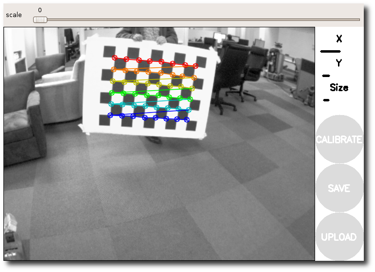

If it does not open up the window try the following parameter:


```
--no-service-check
```

 If you can't see any colored dots make sure
you count the interior vertex points, not the squares!

#### Dual Checkerboards

Starting in Diamondback, you will be able to use multiple size
checkerboards to calibrate a camera.

To use multiple checkerboards, give multiple `\--size` and
`\--square` options for additional boards. Make sure the boards have
different dimensions, so the calibration system can tell them apart.

### Moving the Checkerboard

In order to get a good calibration you will need to move the
checkerboard around in the camera frame such that:

- checkerboard on the camera's left, right, top and bottom of field of
  view
- X bar - left/right in field of view
- Y bar - top/bottom in field of view
- Size bar - toward/away and tilt from the camera
- checkerboard filling the whole field of view
- checkerboard tilted to the left, right, top and bottom (Skew)

At each step, hold the checkerboard still until the image is highlighted
in the calibration window.

  -- ----------------------------------- -- ----------------------------------- -- ----------------------------------- --
     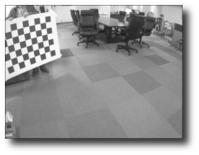      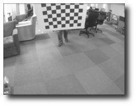         
     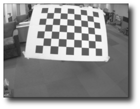      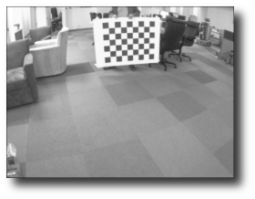         
  -- ----------------------------------- -- ----------------------------------- -- ----------------------------------- --

As you move the checkerboard around you will see three bars on the
calibration sidebar increase in length. When the **CALIBRATE** button
lights, you have enough data for calibration and can click **CALIBRATE**
to see the results.

Calibration can take about a minute. The windows might be greyed out but
just wait, it is working.

. 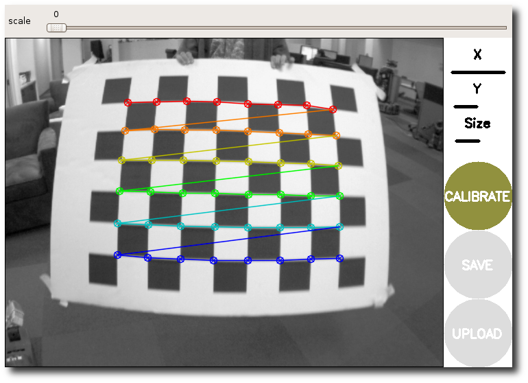

### Calibration Results

After the calibration is complete you will see the calibration results
in the terminal and the calibrated image in the calibration window:

. 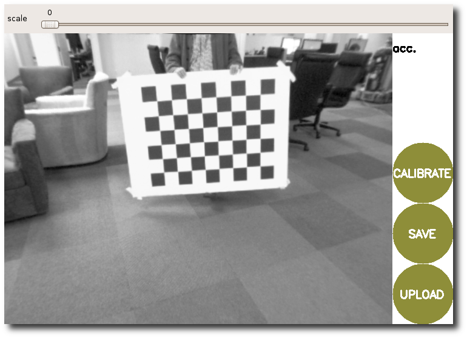

A successful calibration will result in real-world straight edges
appearing straight in the corrected image.

A failed calibration usually results in blank or unrecognizable images,
or images that do not preserve straight edges.

After a successful calibration, you can use the slider at the top of the
calibration window to change the size of the rectified image. A scale of
0.0 means that the image is sized so that all pixels in the rectified
image are valid. The rectified image has no border, but some pixels from
the original image are discarded. A scale of 1.0 means that all pixels
in the original image are visible, but the rectified image has black
borders where there are no input pixels in the original image.


```
D =  [-0.33758562758914146, 0.11161239414304096, -0.00021819272592442094, -3.029195446330518e-05]
K =  [430.21554970319971, 0.0, 306.6913434743704, 0.0, 430.53169252696676, 227.22480030078816, 0.0, 0.0, 1.0]
R =  [1.0, 0.0, 0.0, 0.0, 1.0, 0.0, 0.0, 0.0, 1.0]
P =  [1.0, 0.0, 0.0, 0.0, 0.0, 1.0, 0.0, 0.0, 0.0, 0.0, 1.0, 0.0]
# oST version 5.0 parameters


[image]

width
640

height
480

[narrow_stereo/left]

camera matrix
430.215550 0.000000 306.691343
0.000000 430.531693 227.224800
0.000000 0.000000 1.000000

distortion
-0.337586 0.111612 -0.000218 -0.000030 0.0000

rectification
1.000000 0.000000 0.000000
0.000000 1.000000 0.000000
0.000000 0.000000 1.000000

projection
1.000000 0.000000 0.000000 0.000000
0.000000 1.000000 0.000000 0.000000
0.000000 0.000000 1.000000 0.000000
```

 If you are satisfied with the calibration,
click **COMMIT** to send the calibration parameters to the camera for
permanent storage. The GUI exits and you should see "writing
calibration data to \..." in the console.

### Creating a yml file

The
[Camera Calibration Parser](https://index.ros.org/p/camera_calibration_parsers)
helps you to create a yml file, which you can load with nearly all ros
camera driver using the *camera_info_url* parameter.

### Rectifying an image

Simply loading a calibration file does not rectify the image. For
rectification, use the
[image_proc package](https://index.ros.org/p/image_proc).

## How to Calibrate a Stereo Camera

- **Note:** This tutorial assumes that you have completed the previous
  tutorials: [ROS Tutorials](ROS/Tutorials).
- **Description:** This tutorial cover using the
  camera_calibration's
  `cameracalibrator.py` node to calibrate a stereo camera with a left
  and right image over ROS.
- **Keywords:** stereo, camera, calibration
- **Tutorial Level:** BEGINNER

### Before Starting

Make sure that you have the following:

- a large
  [checkerboard (8x6)](doc/camera_calibration_Tutorials_StereoCalibration_check-108.pdf)
  or [checkerboard (7x6)](doc/check_7x6_108mm.pdf) with known
  dimensions. This tutorial uses a 8x6 checkerboard with 108mm squares
- a well lit 5m x 5m area clear of obstructions and check board patterns
- a stereo camera publishing left and right images over ROS (if you want
  to use two independent cameras as a stereo camera, you must make sure
  the images have identical time stamps)

**NOTE**: Checkerboard size refers to the number of internal corner, as
described in the OpenCV documentation (i.e. the 8x6 checkerboard
contains 9x7 squares)

### Compiling

Start by getting the dependencies and compiling the driver.


```
$ rosdep install camera_calibration
$ rosmake camera_calibration
```


### Camera Publishing

Make sure that your stereo camera is publishing left and right images
over ROS. Let's list the topics to check that the images are published:


```
$ rostopic list
```

 This will show you all the topics published,
check to see that there is a left and right `image_raw` topic:

. 

```
/my_stereo/left/camera_info
/my_stereo/left/image_raw
/my_stereo/right/camera_info
/my_stereo/right/image_raw
/my_stereo_both/parameter_descriptions
/my_stereo_both/parameter_updates
/my_stereo_l/parameter_descriptions
/my_stereo_l/parameter_updates
/my_stereo_r/parameter_descriptions
```


### Start the Calibration

To start the calibration you will need to load the image topics that
will be calibrated:


```
$ rosrun camera_calibration cameracalibrator.py --approximate 0.1 --size 8x6 --square 0.108 right:=/my_stereo/right/image_raw left:=/my_stereo/left/image_raw right_camera:=/my_stereo/right left_camera:=/my_stereo/left
```

 The **\--approximate** option allows the camera
calibrator to work with images that do not have the exact same
timestamp. Currently it is set to 0.1 seconds. In this case, as long as
the timestamp difference is less than 0.1 seconds, the calibrator will
run with no problem.

This will open up the calibration window which will highlight the
checkerboard, you will not see any images in the calibration window
until a checkerboard is present:

. 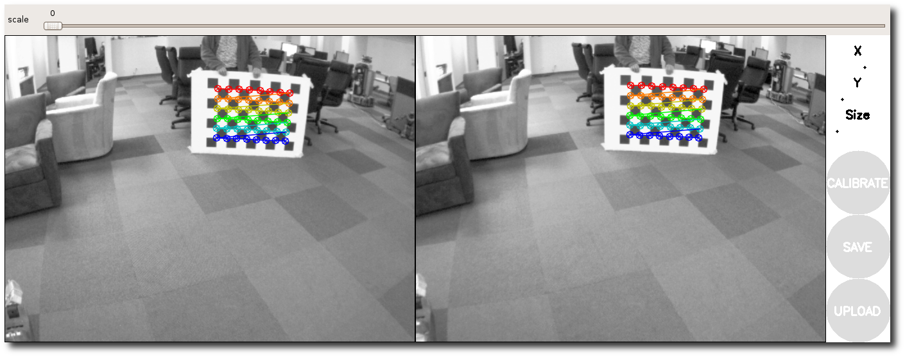

#### Dual Checkerboards

Starting in Diamondback, you will be able to use multiple size
checkerboards to calibrate a camera.

To use multiple checkerboards, give multiple `\--size` and
`\--square` options for additional boards. Make sure the boards have
different dimensions, so the calibration system can tell them apart.

### Holding the Checkerboard

Make sure that you hold the checkerboard horizontally (more checkers
horizontally than vertically).

. 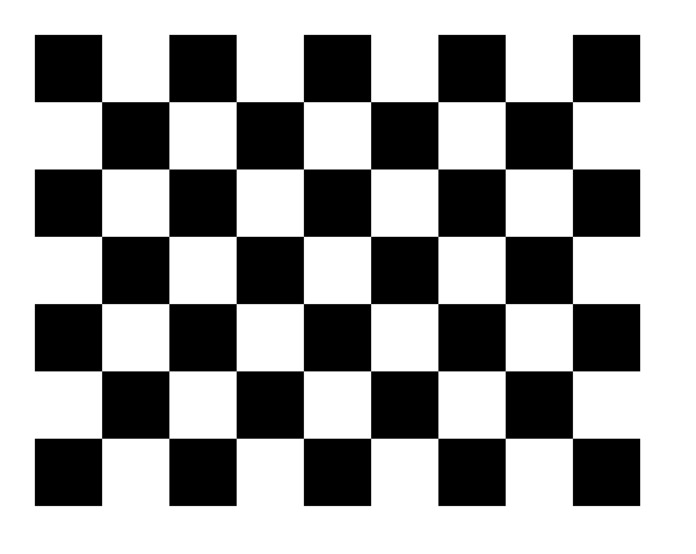

### Moving the Checkerboard

In order to get a good calibration you will need to move the
checkerboard around in the camera frame such that:

- the checkerboard is detected at the left and right edges of the field
  of view (X calibration)
- the checkerboard is detected at the top and bottom edges of the field
  of view (Y calibration)
- the checkerboard is detected at various angles to the camera
  ("Skew")
- the checkerboard fills the entire field of view (Size calibration)
- checkerboard tilted to the left, right, top and bottom (X,Y, and Size
  calibration)

  -- ---------------------------------------------------------------------------------- -- ---------------------------------------------------------------------------------- -- ---------------------------------------------------------------------------------- --
                 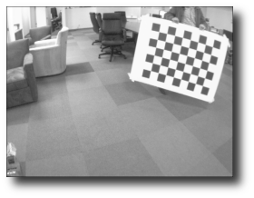   
                 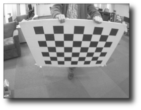   
  -- ---------------------------------------------------------------------------------- -- ---------------------------------------------------------------------------------- -- ---------------------------------------------------------------------------------- --

As you move the checkerboard around you will see three bars on the
calibration sidebar increase in length. When the **CALIBRATE** button
lights, you have enough data for calibration and can click **CALIBRATE**
to see the results.

. 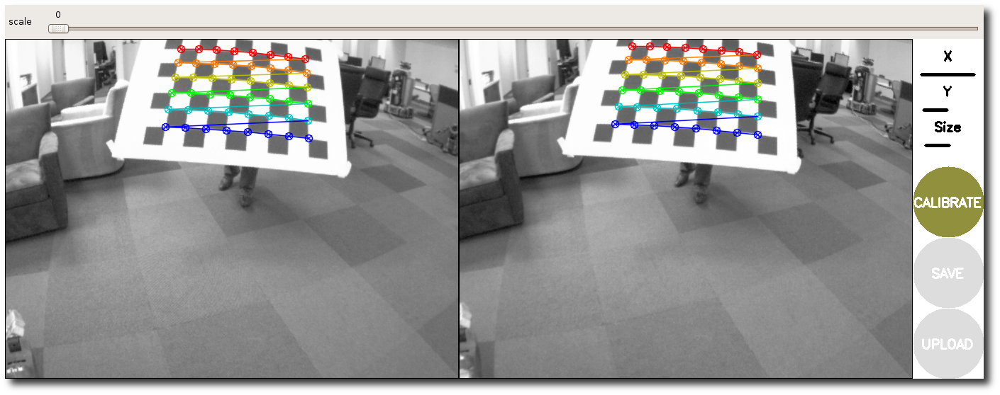

### Calibration Results

After the calibration is complete you will see the calibration results
in the terminal and the calibrated image in the calibration window:

. 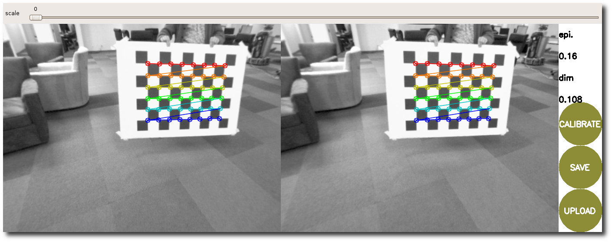

The sidebar will show the measured accuracy and dimensions of the
checkerboard square, in the above case the checkerboard square was 111mm
with an accuracy of 0.31 pixels.

A successful calibration will result in real-world straight edges
appearing straight in the corrected image.

A failed calibration usually results in blank or unrecognizable images,
or images that do not preserve straight edges.

Typically, an epipolar error below 0.25 pixel is considered acceptable,
and below 0.1 excellent.

You can also use the slider at the top of the calibration window to
change the size of the rectified image, as shown below. A scale of 0.0
means that the image is sized so that all pixels in the rectified image
are valid. The rectified image has no border, but some pixels from the
original image are discarded. A scale of 1.0 means that all pixels in
the original image are visible, but the rectified image has black
borders where there are no input pixels in the original image.

**The recommended value for the slider is 0.0.**

. 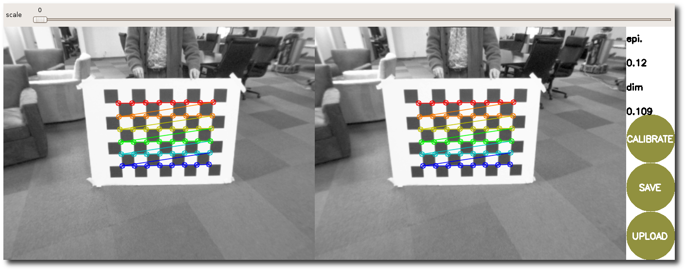
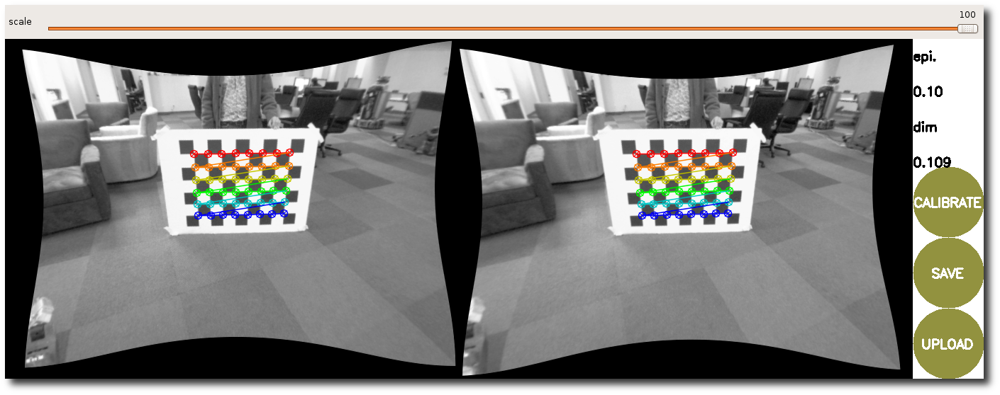

For more details on the stereo camera model - including interpretation
of these results - see
<http://opencv.willowgarage.com/documentation/python/camera_calibration_and_3d_reconstruction.html>
and [image_geometry](https://index.ros.org/p/image_geometry).


```
Left:
D =  [-0.31420196940339423, 0.091934927292188981, 0.0012952332628749881, -0.0016196264582460102]
K =  [425.19601412158482, 0.0, 308.29689772295882, 0.0, 426.02702697756899, 223.53789948448997, 0.0, 0.0, 1.0]
R =  [0.99783514664821127, 0.013543024537547797, 0.064355315242164368, -0.013644479706482148, 0.99990626305523833, 0.0011372231303031885, -0.064333881330776027, -0.0020128560018237928, 0.99792640015365552]
P =  [308.02438413775218, 0.0, 270.8484992980957, 0.0, 0.0, 308.02438413775218, 226.91282844543457, 0.0, 0.0, 0.0, 1.0, 0.0]

Right:
D =  [-0.30550530964404188, 0.082701072309439266, 0.001966752019596593, -0.0016409796174513081]
K =  [425.18741896821433, 0.0, 323.8787136811938, 0.0, 426.46867413824884, 226.19589833365407, 0.0, 0.0, 1.0]
R =  [0.99769116642055589, 0.011418153515469445, 0.066947458627553177, -0.011312576360776634, 0.99993409783500409, -0.0019559148698406695, -0.066965379581335679, 0.0011940507500265176, 0.99775458514623427]
P =  [308.02438413775218, 0.0, 270.8484992980957, -28.144333365644293, 0.0, 308.02438413775218, 226.91282844543457, 0.0, 0.0, 0.0, 1.0, 0.0]
# oST version 5.0 parameters


[image]

width
640

height
480

[narrow_stereo/left]

camera matrix
425.196014 0.000000 308.296898
0.000000 426.027027 223.537899
0.000000 0.000000 1.000000

distortion
-0.314202 0.091935 0.001295 -0.001620 0.0000

rectification
0.997835 0.013543 0.064355
-0.013644 0.999906 0.001137
-0.064334 -0.002013 0.997926

projection
308.024384 0.000000 270.848499 0.000000
0.000000 308.024384 226.912828 0.000000
0.000000 0.000000 1.000000 0.000000


# oST version 5.0 parameters


[image]

width
640

height
480

[narrow_stereo/right]

camera matrix
425.187419 0.000000 323.878714
0.000000 426.468674 226.195898
0.000000 0.000000 1.000000

distortion
-0.305505 0.082701 0.001967 -0.001641 0.0000

rectification
0.997691 0.011418 0.066947
-0.011313 0.999934 -0.001956
-0.066965 0.001194 0.997755

projection
308.024384 0.000000 270.848499 -28.144333
0.000000 308.024384 226.912828 0.000000
0.000000 0.000000 1.000000 0.000000
```

 If you are satisfied with the calibration,
click **COMMIT** (on the pictures above this is button has an old name
**UPLOAD**) to send the calibration parameters to the camera for
permanent storage.

If you want to save the calibration parameters and images used in
calibration, click **SAVE**. Everything will be made available in the
compressed folder /tmp/calibrationdata.tar.gz.
