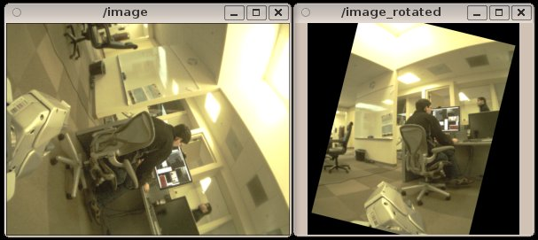

## Example Use

To produce a version of the forearm camera view that always points up:


```
rosrun image_rotate image_rotate image:=l_forearm_cam/image_color \
rotated/image:=l_forearm_cam/image_color_rotated __name:=image_rotater
```

 You can then view it with `image_view`.


```
rosrun image_view image_view image:=l_forearm_cam/image_color_rotated
```

 It is easy to adjust the settings using
`rqt_reconfigure`. 

```
rosrun rqt_reconfigure rqt_reconfigure image_rotater
```


## ROS API

### image_rotate

`image_rotate` is a node to rotate an image for visualization. The
node takes a source vector and a target vector, and projects them onto
the camera image. It then rotates the image by the angle neded to align
the projection of the source vector with the projection of the target
vector. The source and target vectors are specified in arbitrary TF
frames allowing the rotation angle to vary dynamically as frames move
relative to one another. With the default settings, the image will be
rotated so that the top of the image matches the up direction the
`base_link`.

#### Subscribed Topics

- `image`
  ([sensor_msgs/msg/Image](https://docs.ros.org/en/rolling/p/sensor_msgs/msg/Image.html)):
  Image to be rotated (the accompanying camera_info may also be
  subscribed to).

#### Published Topics

- `rotated/image`
  ([sensor_msgs/msg/Image](https://docs.ros.org/en/rolling/p/sensor_msgs/msg/Image.html)):
  Rotated image

#### Parameters

##### Dynamically Reconfigurable Parameters

See the
[dynamic_reconfigure](https://index.ros.org/p/dynamic_reconfigure)
package for details on dynamically reconfigurable parameters.

- `~target_frame_id` (`str`, default: `base_link`): Frame in which the
  target vector is specified. Empty means the input frame.
- `~target_x` (`double`, default: `0.0`): X coordinate of the target
  vector Range: -10.0 to 10.0
- `~target_y` (`double`, default: `0.0`): Y coordinate of the target
  vector Range: -10.0 to 10.0
- `~target_z` (`double`, default: `1.0`): Z coordinate of the target
  vector Range: -10.0 to 10.0
- `~source_frame_id` (`str`): Frame in which the source vector is
  specified. Empty means the input frame.
- `~source_x` (`double`, default: `0.0`): X coordinate of the direction
  the target should be aligned with. Range: -10.0 to 10.0
- `~source_y` (`double`, default: `-1.0`): Y coordinate of the direction
  the target should be aligned with. Range: -10.0 to 10.0
- `~source_z` (`double`, default: `0.0`): Z coordinate of the direction
  the target should be aligned with. Range: -10.0 to 10.0
- `~output_frame_id` (`str`): Frame to publish for the image's new
  orientation. Empty means add '_rotated' suffix to the image frame.
- `~input_frame_id` (`str`): Frame to use for the original camera image.
  Empty means that the frame in the image or camera_info should be used
  depending on use_camera_info.
- `~use_camera_info` (`bool`, default: `True`): Indicates that the
  camera_info topic should be subscribed to to get the default
  input_frame_id. Otherwise the frame from the image message will be
  used.
- `~max_angular_rate` (`double`, default: `10.0`): Limits the rate at
  which the image can rotate (rad/s). Zero means no limit. Range: 0.0 to
  100.0
- `~output_image_size` (`double`, default: `2.0`): Size of the output
  image as a function of the input image size. Can be varied
  continuously between the following special settings: 0 ensures no
  black ever appears, 1 is small image dimension, 2 is large image
  dimension, 3 is image diagonal. Range: 0.0 to 3.0
